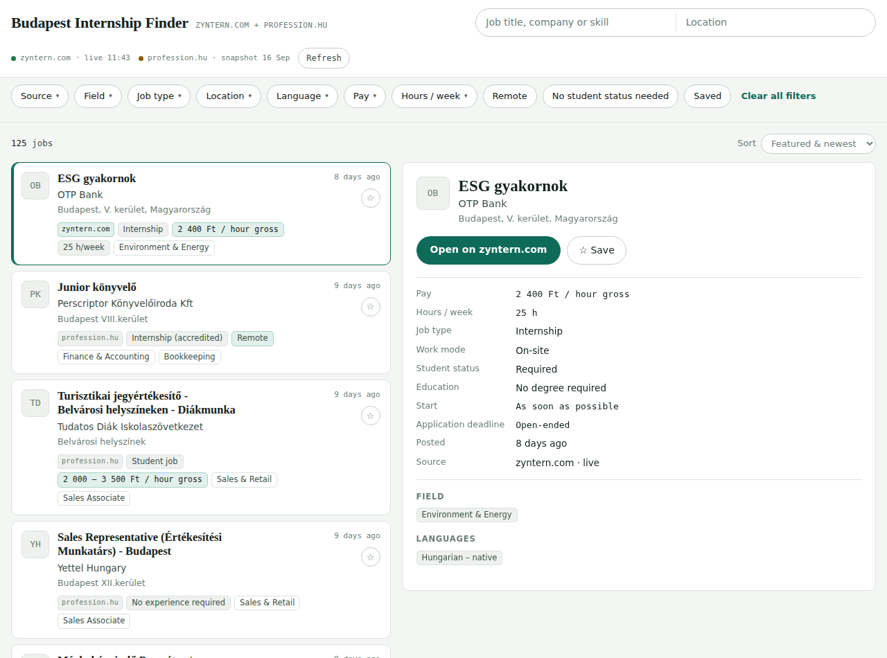

# Budapest Internship Finder

A job search tool for Budapest internship and entry-level roles, pulling from three
Hungarian job portals into one filterable list. Built as a university project for
*Applied programming with AI*.

Open **`internship_finder.html`** in a browser — that is the whole app. No install,
no server, no build step needed to use it.



---

## What it does

Around 240 jobs from three sources, in one LinkedIn-style interface:

| Source | How many | How it gets in |
|---|---|---|
| **zyntern.com** | ~80 | **Live** — fetched from their public API every time you open the page |
| **profession.hu** | 120 | **Snapshot** — harvested in advance and built into the HTML file |
| **cvonline.hu** | 39 | **Snapshot** — same reason |

The two snapshots refresh themselves every morning at 10:00 — see
[Refreshing automatically](#refreshing-automatically-every-day-at-1000). The app shows
the date of each snapshot next to the source name, so you always know how old the jobs
in front of you are.

Filter by source, field, job type, location, language, minimum hourly pay and weekly
hours; search by keyword; sort; save jobs for later. Every job links back to the
original advert.

---

## Why only one source is live

This is the central technical finding of the project, and it drives the whole design.

**zyntern.com has a public API.** Its own front end calls
`GET https://zyntern.com/api/jobs?page=1&limit=100`, which returns clean JSON — no
API key, no login. Crucially it responds with the header:

```
access-control-allow-origin: *
```

That header is a browser permission slip. It means any web page, anywhere, is allowed
to read the response. So `internship_finder.html` can call it directly and always shows
current data.

**profession.hu and cvonline.hu have neither.** No API, and no
`access-control-allow-origin` header. Both were tested directly, by calling them from
a different site's page, and both give the same result:

```
TypeError: Failed to fetch
```

The browser blocks it. This is not something hosting the file differently would fix —
it is the browser enforcing the other site's policy, and no amount of rewriting the
page changes it. So those two have to be collected ahead of time by a program that is
*not* a web page, and embedded in the file. That is what `data/prof_rows.json` and
`data/cvonline_rows.json` are.

If the live zyntern.com call fails for any reason, the page still works with the 159
built-in jobs and says so, rather than showing an empty list. The status line at the
top shows all three sources and whether each is live or a snapshot.

---

## Repository layout

```
internship_finder.html      the finished app — open this
├── src/
│   ├── template_hu.html    Hungarian source template (has a placeholder for the data)
│   └── build_english.py    translates the template to English + embeds the data
├── data/
│   ├── prof_rows.json      profession.hu snapshot, 120 jobs (16 columns per row)
│   ├── cvonline_rows.json  cvonline.hu snapshot, 39 jobs (same 16 columns)
│   ├── snapshot_meta.json  when each snapshot was last collected
│   └── cv.json             CV, structured — input for the match engine
├── scripts/
│   ├── refresh_all.py          both scrapers + rebuild, in one command
│   ├── scrape_profession.py    refreshes data/prof_rows.json
│   ├── scrape_cvonline.py      refreshes data/cvonline_rows.json
│   ├── harvest_profession.js   same job as scrape_profession.py, from the browser
│   ├── match_engine.py         scores jobs against the CV
│   ├── refresh_daily.bat       what the Windows 10:00 schedule runs
│   ├── install_daily_task.bat  sets that schedule up (double-click once)
│   └── uninstall_daily_task.bat   removes it again
├── .github/workflows/
│   └── daily-refresh.yml   the same refresh, run daily by GitHub instead
│                           (added through the GitHub website — see below)
└── tests/
    ├── verify.js           end-to-end browser test
    └── fixture.js          fake API response used by the test
```

`internship_finder.html` is generated, but it is committed on purpose — it is the
deliverable, and anyone cloning the repo should be able to open it without running a
build.

---

## Rebuilding the app

Only needed after editing the template or refreshing the data.

```bash
python src/build_english.py
```

This reads `src/template_hu.html`, applies the Hungarian→English translation, splices
in `data/prof_rows.json`, and writes `internship_finder.html`.

**On translation:** the interface is English, but job titles and company names stay
exactly as the portals publish them — that is the real advert text. In between sit the
closed vocabularies (category names, job types, languages, schedule terms), which are
translated through lookup tables in `build_english.py`. Anything not in a table passes
through unchanged, so a new category appearing in the API still shows up instead of
disappearing. The script reports any replacement whose target text it could not find,
so an edit to the template cannot silently skip a translation.

Because the categories are English but the titles are Hungarian, each job also keeps
its original Hungarian category names and the search covers both — "controlling" and
"kontrolling" return the same results.

## Refreshing the data

**zyntern.com** — nothing to do. It is fetched live; the "Refresh" button re-fetches it.

**profession.hu and cvonline.hu** — one command, about five minutes:

```bash
pip install requests beautifulsoup4     # once
python scripts/refresh_all.py
```

That runs both scrapers and rebuilds the app. Add `profession` or `cvonline` to the
command to do just one of them.

Most of the five minutes is waiting on purpose: cvonline.hu's robots.txt asks for
`Crawl-delay: 10`, so there is a ten-second pause between its pages.

**If a portal is down, nothing is lost.** Each scraper writes its data file only after
it has collected a sensible number of jobs (at least 40 for profession.hu, 15 for
cvonline.hu). Below that — a dropped connection, or the portal redesigning its pages —
it exits without touching anything, so you keep yesterday's jobs instead of ending up
with an almost empty app. `refresh_all.py` then rebuilds anyway and tells you which
portal failed.

The snapshot dates shown in the app are not typed in by hand. Each scraper stamps
`data/snapshot_meta.json` with the day it ran, and `build_english.py` reads it.

`scripts/harvest_profession.js` does the same harvest from the browser console, if you
ever want to refresh profession.hu without Python.

---

## Refreshing automatically every day at 10:00

Two ways, and they do the same thing. Pick one — running both just does the work twice.

### Option A — GitHub does it (recommended)

`.github/workflows/daily-refresh.yml` runs every day at 10:00 Budapest time on GitHub's
computers: it refreshes both portals, rebuilds the app and commits the result. Your own
PC can be switched off.

**Adding it**, once the repository is on GitHub — do this on the website rather than in
Explorer, which dislikes folder names beginning with a dot:

1. Open your repository on github.com → **Add file** → **Create new file**
2. Type this as the file name, slashes included — GitHub creates the folders for you:
   `.github/workflows/daily-refresh.yml`
3. Paste in the contents of `daily-refresh.yml` and commit.

To check on it afterwards, or to run it right now, open the **Actions** tab, pick
**Daily job refresh**, and use **Run workflow**.

Three things worth knowing:

- **Daylight saving.** GitHub schedules are in UTC and do not follow Hungarian clock
  changes, so the workflow is scheduled twice — 08:00 and 09:00 UTC — and the first step
  lets only the one that is genuinely 10:00 in Budapest continue. The other stops
  instantly. That check also acts as a free retry: if the 10:00 run fails, today's data
  is not stamped, so the second schedule tries again.
- **GitHub pauses schedules on sleepy repositories.** If nobody pushes anything for 60
  days, GitHub disables the schedule and emails you. One click in the Actions tab turns
  it back on.
- **It might not work at all, and that is worth writing up.** The scrapers would be
  running from a datacentre rather than a Hungarian home connection, and portals
  sometimes block that. If the Actions runs start failing where the same script works on
  your own machine, that is the likely reason — and it is a genuinely interesting finding
  for the project rather than a defeat. Use Option B in that case.

### Option B — your own Windows PC does it

Double-click **`scripts/install_daily_task.bat`**. It registers a Windows scheduled task
called *Project_job daily refresh* that runs every day at 10:00. No administrator rights
needed. `scripts/uninstall_daily_task.bat` removes it again.

This needs Python installed and on your PATH — check by opening Command Prompt and
typing `python --version`. If that fails, reinstall Python from python.org and tick **Add
python.exe to PATH** during the install.

Two things worth knowing:

- **Your PC has to be on and awake at 10:00.** If it is off, Windows skips that day. To
  make it catch up instead: Task Scheduler → find the task → Properties → Settings → tick
  *Run task as soon as possible after a scheduled start is missed*.
- **Every run is logged** to `logs/refresh.log`, so you can see afterwards what happened.
  That file is gitignored.

You can also just double-click `scripts/refresh_daily.bat` whenever you want a refresh
on the spot.

---

## The other scripts

**`scripts/match_engine.py`** — scores every job against the CV using weighted keywords
(`kontrolling` 10, `pénzügy` 8, `elemző` 7, and so on down to 1 for fields the CV does
not really support), and ranks them. It prints which keywords matched each job, so the
score is explainable rather than a black box.

```bash
python scripts/match_engine.py data/cv.json <jobs.json> matched.json
```

Its keyword list is Hungarian, so feeding it the English-category data would need the
weights extended — noted as future work below.

---

## Testing

```bash
npm install playwright
node tests/verify.js
```

The test stubs the zyntern.com API with `tests/fixture.js` (a fake response in the real
response shape) so it runs offline and deterministically. It checks that both sources
merge, the filters and facet counts work, search finds both languages, the labels are
English, the per-source "Open on…" link is right, the page degrades gracefully when the
API is unreachable, and that nothing overflows horizontally at 400px wide.

Three real bugs were caught this way: a multi-select dropdown that closed after each
tick, a header too wide to wrap on mobile, and the search regression from translating
the categories.

---

## Known limitations

- The profession.hu and cvonline.hu halves are at most a day old once the 10:00 schedule
  is running, and older than that if it is not — a job may already be filled. Only
  zyntern.com is current on every single open.
- profession.hu is filtered to four fields (finance, sales, marketing, management) and
  capped at 120 — it is not everything the portal has.
- cvonline.hu contributes only 39 jobs. That is not a bug: their Budapest student-job
  pool is 329 adverts, but it is dominated by hospitality and manual work (93 trade,
  41 kitchen, 31 waiting staff), so only 39 fall in the four target fields.
- LinkedIn is deliberately absent. Its robots.txt prohibits automated access without
  written permission, most listings need a login, and harvesting through a personal
  account risks that account.
- The CV match score is not wired into the interface yet; it runs separately.
- Company logos come from zyntern.com, so they do not load offline — the app falls back
  to the company's initials.

## Courtesy

The harvester pauses 650 ms between requests and collects roughly 40 pages in a run.
Both portals are read only through their ordinary public pages, with no login and no
attempt to get around anything. If you raise the volume, raise the delay too.
